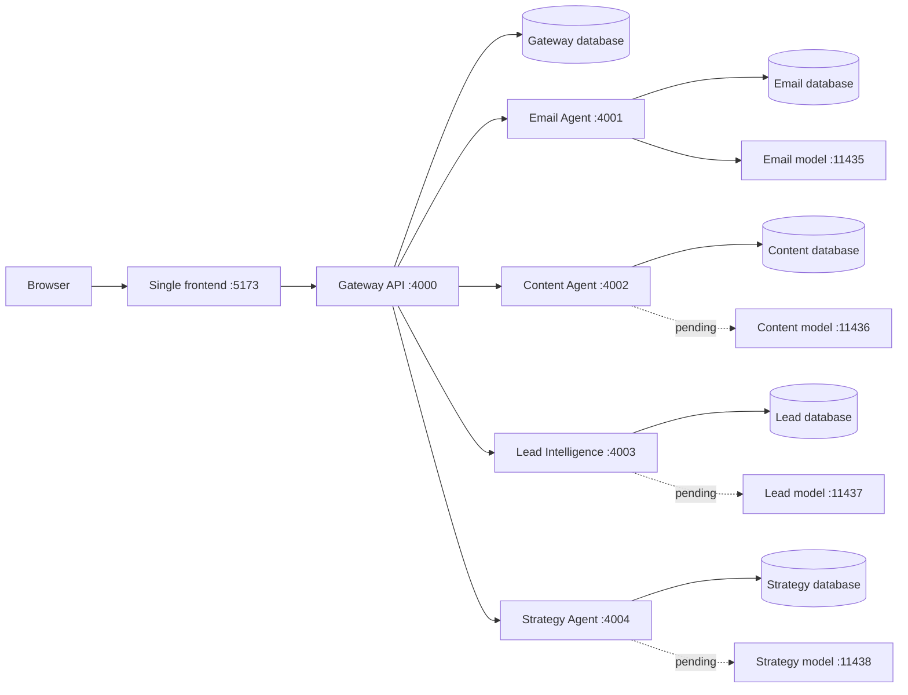

# Application boundaries

The browser imports one shared API client and uses only same-origin `/api` requests. Frontend feature code never connects to service ports or model endpoints. Gateway checks the current database-backed session and permissions, applies request protection/rate limiting, and selects a fixed configured upstream. Client-provided target URLs and identity headers are not forwarded.

Gateway signs a short-lived identity envelope for Email Agent with a distinct service secret, exact method/path and body digest. Email Agent verifies signature, issuer, audience, expiry and binding before authorizing the request. The current platform role is used on every request. Only the minimal tenant/user projection needed for local foreign keys and row-level security is created in the email database. Passwords and browser sessions are not copied. Existing email knowledge and sequences remain in the email database; unrelated platform knowledge is not silently synchronized.

Each API owns its database migrations and repository code. Model training/serving assets belong under `ml/<agent>`, and trained weights under ignored `ml/models`. No sibling frontend builds or service-owned web apps remain in the active source tree.

Content, lead and strategy APIs/model runtimes currently return `503 not_implemented`. Their UI modules render normal unavailable states until implemented. Gateway availability checks API `/health`; agents no longer need to host HTML pages. Cross-agent business data exchange is not implemented by a folder restructure.

The migration retained database/model volume names and the saved adapter's bytes. See [move record](structure-migration.json). Historical evidence lives in `docs/evidence`; embedded old paths in immutable logs/workbooks describe the original audited snapshot.
